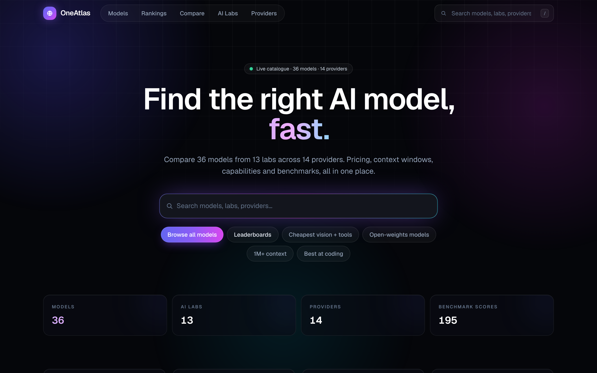
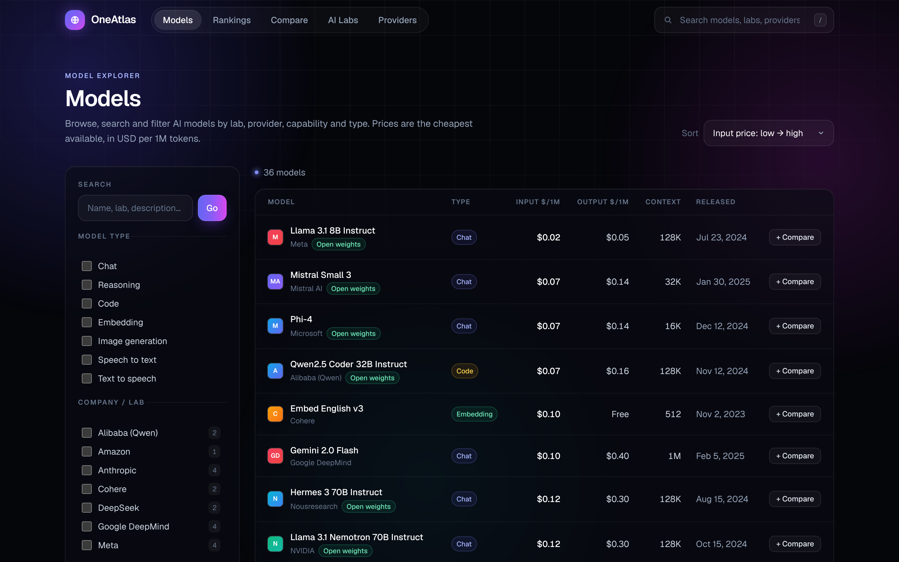
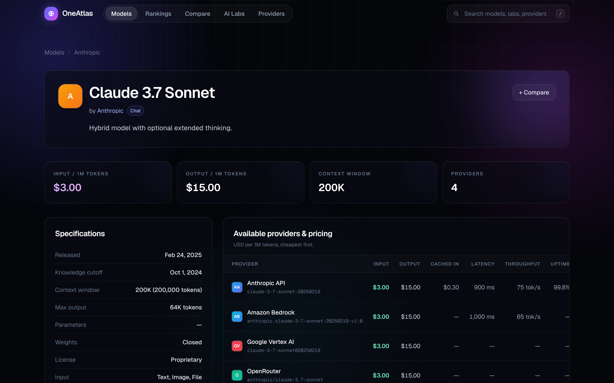
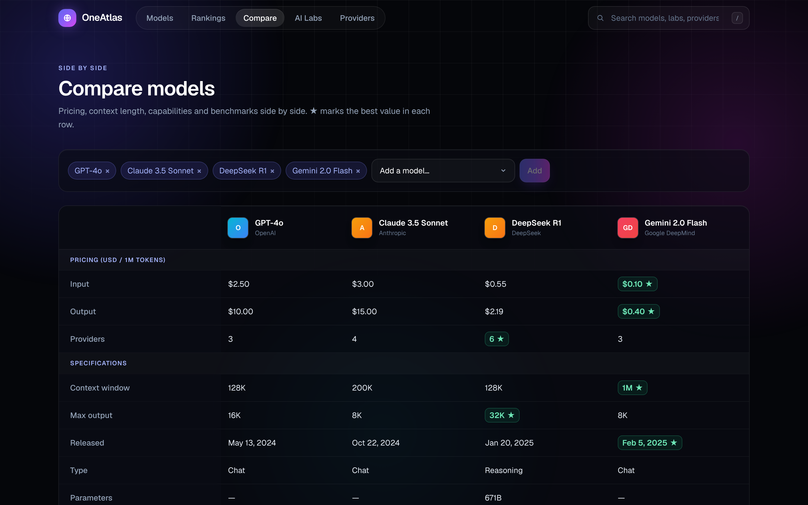
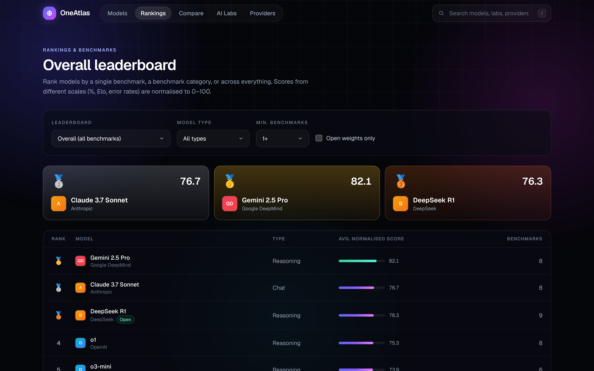
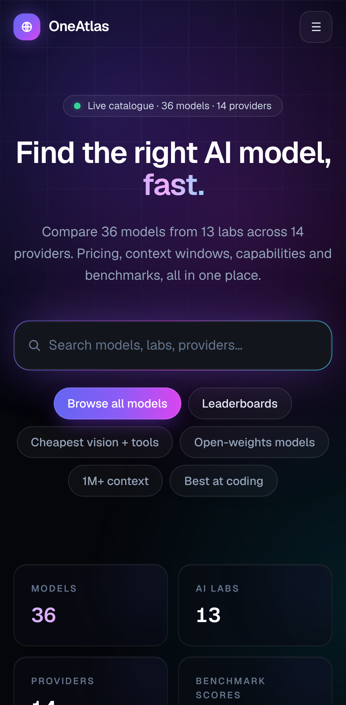
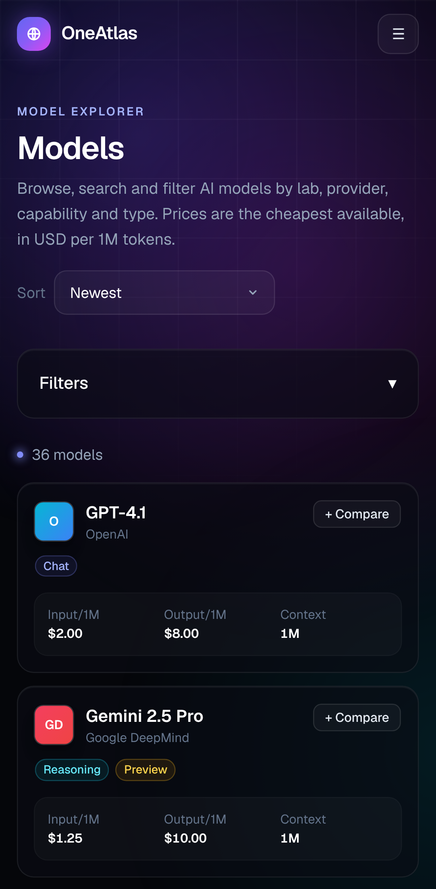
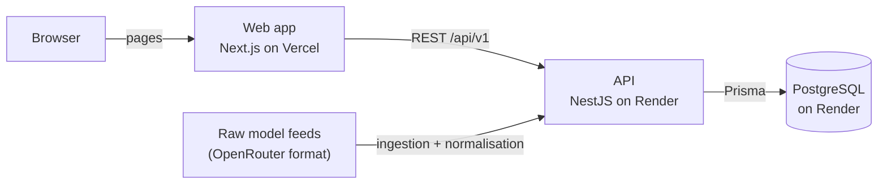

# OneAtlas

**Find, compare and evaluate AI models in one place.**

OneAtlas is a catalogue of AI models (GPT, Claude, Gemini, Llama, DeepSeek and more). For each model it shows the
price on every provider that serves it, its context window, its capabilities and its benchmark scores, plus
leaderboards and side-by-side comparison.

It was built for the **AI Software Engineer Internship** assignment, applying for the **Backend Engineer** role. The
backend is the focus, but the full product (backend, database, frontend, deployment) is complete and tested.

| | |
|---|---|
| 🌐 **Live website** | **https://oneatlas-one.vercel.app** |
| ⚙️ **Live API** | https://oneatlas-api.onrender.com |
| 📖 **Interactive API docs** | https://oneatlas-api.onrender.com/docs |

> The API runs on Render's free plan, which sleeps after 15 minutes without traffic. If the site is slow to load the
> first time, wait about 50 seconds while it wakes up, then it's fast.



---

## Contents

1. [What you can do](#what-you-can-do)
2. [How it works](#how-it-works)
3. [Tech stack](#tech-stack)
4. [Project structure](#project-structure)
5. [Run it on your computer](#run-it-on-your-computer)
6. [Testing](#testing)
7. [Deployment](#deployment)
8. [Assignment checklist](#assignment-checklist)
9. [Key engineering decisions](#key-engineering-decisions)
10. [Limitations](#limitations)

---

## What you can do

| Feature | Where | What it does |
|---|---|---|
| **Explore models** | [`/models`](https://oneatlas-one.vercel.app/models) | Search, filter by company, provider, capability, type, modality, open weights, context size and price. Sort by price, context, release date and more. |
| **Model details** | e.g. [`/models/gpt-4o`](https://oneatlas-one.vercel.app/models/gpt-4o) | Specs, the price on **every provider** (cheapest highlighted), **price history**, capabilities and benchmark scores. |
| **Compare** | [`/compare`](https://oneatlas-one.vercel.app/compare?models=gpt-4o,claude-3.5-sonnet,deepseek-r1) | Up to 6 models side by side; the best value in each row is marked ★. Add models from anywhere with "+ Compare". |
| **Leaderboards** | [`/rankings`](https://oneatlas-one.vercel.app/rankings) | Rank models overall, by category (coding, math…) or by a single benchmark. |
| **AI labs** | [`/labs`](https://oneatlas-one.vercel.app/labs) | Every company, with its models on a release timeline. |
| **Providers** | [`/providers`](https://oneatlas-one.vercel.app/providers) | Every API provider, with the models it serves and its prices. |
| **Global search** | search box on every page (press `/`) | Finds models, labs, providers and benchmarks at once. |

| Model explorer | Model details |
|---|---|
|  |  |
| **Comparison** | **Leaderboard** |
|  |  |

<p align="center">
  
  &nbsp;&nbsp;
  
  <br/><em>Fully responsive: it works on phones too.</em>
</p>

---

## How it works



Three parts, each with one job:

1. **PostgreSQL database**: stores labs, providers, models, prices and benchmark scores.
   - A model's price is stored **per provider**, because the same model costs different amounts on different providers.
   - The database enforces data rules itself (e.g. prices can't be negative), so bad data can't get in even by mistake.
2. **API (backend)**: the brain.
   - Answers questions like "the cheapest models with vision and tool calling" or "the top models at coding".
   - Validates every request and returns clear errors.
   - Can import raw model lists from other platforms, converting their formats into OneAtlas's own.
3. **Web app (frontend)**: what you see.
   - Pages are built on the server from API data, so they load with content already in place, even without JavaScript.

Every filter, sort and comparison is part of the URL, so any view can be bookmarked or shared.

---

## Tech stack

| Layer | Technology |
|---|---|
| Frontend | Next.js 15 · React 19 · TypeScript · Tailwind CSS |
| Backend | Node.js 22 · TypeScript · NestJS 11 |
| Database | PostgreSQL 16 · Prisma ORM |
| Testing | Jest + Supertest (API) · Vitest + Playwright (web) |
| Hosting | Vercel (web) · Render (API + database) · GitHub Actions (CI) |

---

## Project structure

```
One-Atlas/
├── oneatlas-api/          ← backend (NestJS + Prisma)        → see oneatlas-api/README.md
│   ├── prisma/            ←   database schema + migrations
│   ├── src/               ←   API modules: models, labs, providers, rankings, search, ingestion…
│   └── test/              ←   end-to-end tests against a real PostgreSQL
├── oneatlas-web/          ← frontend (Next.js + Tailwind)     → see oneatlas-web/README.md
│   ├── src/app/           ←   pages
│   ├── src/components/    ←   reusable UI pieces
│   └── e2e/               ←   browser tests (Playwright)
├── scripts/live-check.mjs ← checks the DEPLOYED site from the outside
├── .github/workflows/     ← CI (runs all tests on every push) + live check
├── docker-compose.yml     ← run everything locally with one command
└── render.yaml            ← Render deployment blueprint
```

---

## Run it on your computer

### Option A: one command with Docker (easiest)

Requires [Docker Desktop](https://www.docker.com/products/docker-desktop/).

```bash
git clone https://github.com/sheetanshumohan/one-atlas.git
cd one-atlas
docker compose up --build
```

Then open **http://localhost:3001**. API docs are at http://localhost:3000/docs. The database is created and filled
with demo data automatically.

### Option B: without Docker

Requires **Node.js 20+** and **PostgreSQL 16**.

```bash
# 1. Backend
cd oneatlas-api
npm install
cp .env.example .env            # then set DATABASE_URL to your PostgreSQL database
npm run build
npm run start:demo              # creates the tables, loads demo data, starts the API on :3000

# 2. Frontend (in a second terminal)
cd oneatlas-web
npm install
npm run build
API_URL=http://localhost:3000 npm start      # website on :3001
```

---

## Testing

The project has **580+ automated tests**. They all run on every push to GitHub (CI), and a separate check runs the
browser tests against the **live** website.

| Suite | Count | What it proves |
|---|---|---|
| API unit tests | 197 | The logic is correct on its own: price conversion, ranking maths, search safety, validation rules… |
| API end-to-end tests | 288 | Every endpoint works against a **real PostgreSQL**: filters, sorting, pagination, errors, security, price history, `/meta` facets matching real filter results, data consistency under concurrent writes. |
| Web unit tests | 31 | Formatting and URL-state helpers. |
| Browser tests | 72 | A real browser (desktop **and** phone sizes) uses the site: search, filters, compare, rankings, 404s, works without JavaScript, no console errors, no layout overflow, and **every option and count on screen matches the API** (proves nothing is hard-coded). |
| Live check | ~650 API checks + the 72 browser tests | Runs against the deployed site from GitHub Actions. |

```bash
cd oneatlas-api && npm test        # needs a PostgreSQL test database (see oneatlas-api/README.md)
cd oneatlas-web && npm test        # unit tests
cd oneatlas-web && npm run test:e2e   # browser tests (needs the API + web app running)
```

---

## Deployment

| Part | Where | How it updates |
|---|---|---|
| Website | Vercel | Automatically on every push to `main` |
| API | Render (Node 22) | Automatically on every push to `main`; database migrations run on start-up |
| Database | Render PostgreSQL 16 | Managed by Render |

To re-check the live site: **GitHub → Actions → "Live deployment check" → Run workflow**, and fill in the website URL.

To deploy your own copy, connect this repo to Render as a **Blueprint** (it reads `render.yaml`) and to Vercel with
root directory `oneatlas-web`. Set the same random string as `TRUSTED_CLIENT_KEY` on the API and `API_CLIENT_KEY` on
the website, and set the website's `API_URL` to the API's URL.

---

## Assignment checklist

| Requirement from the brief | Done |
|---|---|
| Browse & search models; filter by company, provider, capabilities, type; sort by price, context, release date | ✅ |
| Model detail: specs, input/output pricing, context, modalities, capabilities, providers, benchmarks | ✅ |
| Compare multiple models: pricing, context, capabilities, benchmarks | ✅ |
| Rankings & leaderboards, filter by category and benchmark, comparative scores | ✅ |
| AI labs directory with their models & releases; providers with their models | ✅ |
| Clean navigation, global search, responsive layouts, consistent UX | ✅ |
| Data managed through database + APIs (nothing hard-coded in the frontend) | ✅ |
| Backend: APIs, schema & relations, search/filter/pagination, pricing & benchmark management, validation, normalisation, error handling | ✅ |
| Mandatory stack: Next.js/React/TS/Tailwind · Node/TS/NestJS · PostgreSQL/Prisma | ✅ |
| Live URL + GitHub repo | ✅ |

---

## Key engineering decisions

Short version below; the full reasoning is in [`oneatlas-api/README.md`](oneatlas-api/README.md) and
[`oneatlas-web/README.md`](oneatlas-web/README.md).

- **All data is managed by the database and API; the frontend hard-codes nothing.** `GET /api/v1/meta` serves
  every filter option (with live counts), label, sort option and limit straight from the database. Browser tests
  check that the screen matches the API exactly.
- **Price history is an append-only audit log** written in the same transaction as every price change (API,
  ingestion, seed), so history can never disagree with current prices.
- **Prices live on the provider offering**, not on the model. A "cheapest price" summary on each model makes sorting
  fast. It's updated in the same database transaction as any price change, with row locking, so it can never go
  stale, even under simultaneous updates (a test proves this).
- **Benchmarks are normalised to 0–100** (higher is always better), so different scales like percentages, Elo
  ratings and error rates can be ranked together.
- **Strict validation everywhere**: unknown fields are rejected, numbers aren't silently converted, and every error has
  the same clear format.
- **Exact money maths**: prices are converted with decimal arithmetic, because plain floating point turns
  `0.0000029 × 1,000,000` into `2.9000000000000004`.
- **Safe search**: typing `%` or `_` can't match everything, because LIKE wildcards are escaped.
- **Same results on every server**: name sorting doesn't depend on the database's language settings. Testing the live
  deployment caught that difference.
- **Security**: reading is public; writing needs an admin key. Writes are switched off entirely if no key is set. There
  is also rate limiting and security headers.
- **Fast, accessible UI**: pages are server-rendered, effects respect "reduced motion", and the glow effects use
  gradients instead of expensive blur filters.

---

## Limitations

- Prices and benchmark scores are an **illustrative snapshot** of public figures. The brief allows mock data. Everything
  is still served from the database through the API.
- Free hosting: the API sleeps when idle (~50 seconds to wake up), and Render's free database expires after 30 days.
- Adding or editing data is done through the API (admin key) or the ingestion command. There is no admin screen in the
  web app.
