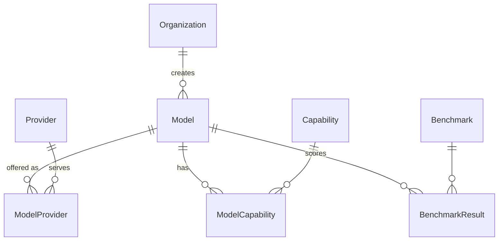

# OneAtlas API — AI Model Discovery & Intelligence Platform (Backend)

Backend for [OneAtlas](https://oneatlas.dev/), built for the **Backend Engineer** role. It lets developers
discover, compare and evaluate AI models across providers. The REST API covers models, AI labs, inference providers,
pricing, capabilities, benchmarks, rankings, global search and data ingestion.

**Stack:** Node.js 22 · TypeScript (strict) · NestJS 11 · PostgreSQL 16 · Prisma 6 · Jest + Supertest

| | |
|---|---|
| Interactive API docs (Swagger UI) | `GET /docs` |
| OpenAPI 3 spec | `GET /docs-json` |
| Base path | `/api/v1` |
| Tests | **454 tests** (181 unit + 273 e2e against a real PostgreSQL), ~97% line coverage |
| Web app | [`../oneatlas-web`](../oneatlas-web/README.md): the Next.js + Tailwind product UI built on this API |

---

## Quick start

```bash
cd oneatlas-api
cp .env.example .env            # set DATABASE_URL and ADMIN_API_KEY
npm install
npm run db:migrate              # prisma migrate deploy
npm run db:seed                 # 12 labs, 14 providers, 35 models, 11 benchmarks, ~200 scores
npm run dev                     # http://localhost:3000/docs
```

Try it:

```bash
curl 'localhost:3000/api/v1/models?capability=tool-calling,vision&sort=inputPrice&pageSize=5'
curl 'localhost:3000/api/v1/models/compare?models=gpt-4o,claude-3.5-sonnet,gemini-2.0-flash'
curl 'localhost:3000/api/v1/rankings?category=CODING&minBenchmarks=2'
curl 'localhost:3000/api/v1/search?q=llama'
```

Ingest a raw catalogue (OpenRouter `/api/v1/models` format) through the same normaliser the API uses:

```bash
npm run ingest -- prisma/data/openrouter-sample.json --provider openrouter --dry-run
npm run ingest -- prisma/data/openrouter-sample.json --provider openrouter
```

---

## Architecture

```
src/
├── main.ts / bootstrap.ts     # app bootstrap; configureApp() is shared with the e2e tests
├── config/                    # env validation (fails fast at boot)
├── prisma/                    # PrismaService (connection lifecycle)
├── common/                    # cross-cutting concerns
│   ├── filters/               #   global exception filter → one error envelope
│   ├── guards/                #   admin API-key guard (constant-time compare, fails closed)
│   ├── middleware/            #   request-id propagation
│   ├── interceptors/          #   Cache-Control for public reads
│   ├── dto/ utils/ validators #   pagination, strict query transforms, slugs, scoring, LIKE-escaping
├── models/                    # discovery, detail, compare, offerings & benchmark-score management
├── organizations/             # AI labs & companies directory
├── providers/                 # inference provider directory
├── benchmarks/  rankings/     # benchmark catalogue + leaderboards
├── capabilities/ search/ stats/ health/
├── pricing/                   # owns the denormalised price summary (consistency + row locking)
├── ingestion/                 # pure normaliser + idempotent ingestion service
└── cli/ingest.ts              # CLI wrapper around IngestionService
```

Each feature module follows the same layering:

- **Controller**: HTTP only.
- **Service**: business rules and transactions.
- **Presenter**: maps DB rows to the public JSON, e.g. `Decimal` → number and `Date` → `YYYY-MM-DD`.
- **Pure functions**: query builder, leaderboard, comparison and normaliser. They have no I/O, so they are unit-tested directly.

### Data model



| Table | Purpose / key design points |
|---|---|
| `Organization` | AI lab / company (type, country ISO-2, founded year). `onDelete: Restrict`: you can't delete a lab that still owns models (API returns 409). |
| `Provider` | Inference platform (OpenAI API, Bedrock, Groq, Together…). Separate from Organization because one provider serves many labs' models. |
| `Model` | Specs: type, status, release date, context, max output, params, open weights, license, input/output modalities (Postgres enum arrays). |
| `ModelProvider` | **Pricing lives on the offering**, because the same model costs different amounts on different providers. Unique `(modelId, providerId)`. Also stores latency, throughput, uptime and `isAvailable`. |
| `Capability` / `ModelCapability` | Normalised capability catalogue (M:N), e.g. `tool-calling` or `vision`, instead of free-text tags. |
| `Benchmark` / `BenchmarkResult` | Each benchmark declares its scale (`minScore`, `maxScore`, `higherIsBetter`, `unit`), so Elo ratings, percentages and error rates can be ranked together. Unique `(modelId, benchmarkId)`. |

**Integrity is enforced in the database too, not only in the API:**
- CHECK constraints: non-negative prices, positive context and token limits, uptime between 0 and 100, `maxScore > minScore`.
- Unique keys and foreign keys with deliberate cascade/restrict rules.
- The e2e suite writes directly with Prisma, bypassing the API, to prove these constraints hold.

**Indexes:**
- B-tree indexes on every sortable or filterable column (type, release date, context, min prices, foreign keys).
- `(benchmarkId, score)` for leaderboards.
- `pg_trgm` GIN indexes on model/org/provider names and model slugs, so `ILIKE '%q%'` search is index-assisted.

### Key technical decisions

1. **Denormalised price summary with a consistency guarantee.** `Model.minInputPrice`, `minOutputPrice` and `providerCount` let the API sort and filter by price with a plain indexed column instead of an aggregate join on every list request.
   - `PricingService` recomputes them inside the same transaction as every offering write. That covers create, update and delete, provider deletion (cascade) and ingestion.
   - Each such transaction first takes `SELECT … FOR UPDATE` on the model row(s), in sorted order to avoid deadlocks. Without this lock, two concurrent READ COMMITTED transactions can persist a stale summary. An e2e race test reproduced that failure before the fix and passes after it.
   - The e2e write suites assert the invariant (summary == fresh aggregate) after **every** test. `POST /ingest/recompute-pricing` is a repair endpoint.
2. **Normalised benchmark scores.** Every score is mapped to 0–100, where 100 is always best (`normalizeScore`). That makes it possible to:
   - rank lower-is-better benchmarks;
   - compare Elo ratings with percentages;
   - aggregate category and overall leaderboards.

   Ties share a rank (competition ranking: 1, 2, 2, 4). `minBenchmarks` stops a model with one lucky score from topping an aggregate board.
3. **Strict validation everywhere.**
   - Unknown fields and query params are rejected.
   - Implicit type conversion is off, because `"false"` would otherwise become `true`. Numeric and boolean query params are parsed by hand, strictly.
   - Request bodies are never coerced: `"64000"` is not a number.
   - Cross-field rules: `maxOutputTokens ≤ contextWindow`, `cachedInput ≤ input`, score within the benchmark's range, `min ≤ max` for range filters, and no benchmark rescale that would orphan existing scores.
   - PATCH uses `null` to clear nullable fields and rejects `null` for required ones.
4. **Search safety.** Prisma's `contains` does **not** escape LIKE wildcards, so `?q=%` used to match every row. A smoke test caught this. All search input now goes through `escapeLike`.
5. **Deterministic pagination.** Every sort has a unique tie-breaker (`name`, then `slug`). Unknown values (no price, no release date) sort last in **both** directions. Pages never overlap or skip rows.
6. **Ingestion and normalisation** (`ingestion/normalizer.ts`, pure and unit-tested). It converts raw OpenRouter-style records into the canonical model:
   - **Pricing:** USD-per-token strings become USD-per-1M, using exact `Decimal` maths. Plain float multiplication gives `0.0000029 × 1e6 = 2.9000000000000004`.
   - **IDs:** vendor prefixes map to canonical labs (`meta-llama/*` → `meta`, `mistralai/*` → `mistral-ai`), and vendor prefixes are stripped from display names.
   - **Modalities and capabilities:** modalities are parsed from arrays or from `"text+image->text"`. `supported_parameters` maps to capability slugs, and model type is inferred.
   - **Bad data:** implausible dates, unit errors (sanity cap) and inconsistent cached prices are rejected or dropped.
   - **Per-record isolation:** each record gets its own transaction, so one bad record never fails the batch. The report gives `created`, `updated`, `skipped` and `errors`, each with its index and reason.
   - **Idempotency and safety:** re-ingesting creates nothing new. The feed never erases curated data with unknowns and only **adds** capabilities. A slug collision across organisations is refused. `dryRun` previews without writing.
7. **Errors and reliability.**
   - One error envelope everywhere: `{ statusCode, error: { code, message, details? }, path, timestamp, requestId }`.
   - Prisma errors map to the right status: P2002 → 409, P2025 → 404, P2003 → 409, check violation → 400. A database outage returns 503.
   - Body-parser errors map to 400/413. Unknown errors become a 500 with no internals leaked.
   - Every response carries `X-Request-Id`.
   - Also in place: Helmet, CORS, gzip, per-IP rate limiting (429), weak ETags with `If-None-Match` → 304, short `Cache-Control` on public reads, and `trust proxy` for PaaS load balancers.
8. **Security.**
   - Reads are public. Writes need `x-api-key` (or `Authorization: Bearer`), compared in constant time.
   - Auth runs before validation.
   - If no key is configured, writes are **disabled** (fail closed). Production requires a key of at least 16 characters, or the app refuses to boot.

---

## API reference (summary)

Full, interactive reference: **`/docs`**. All prices are **USD per 1M tokens**. List endpoints return
`{ data, meta: { page, pageSize, total, totalPages, hasNextPage, hasPreviousPage } }` (`pageSize` ≤ 100).

| Method | Path | Description |
|---|---|---|
| GET | `/models` | Search & filter. `q`, `organization`, `provider`, `capability` (ALL-of), `type`, `status`, `inputModality`, `outputModality`, `openWeights`, `minContext`, `maxContext`, `maxInputPrice`, `maxOutputPrice`, `releasedAfter`, `releasedBefore`, `sort` (`releaseDate`·`name`·`contextWindow`·`inputPrice`·`outputPrice`·`providerCount`·`createdAt`), `order`, `page`, `pageSize`. List filters accept `a,b` or repeated params. |
| GET | `/models/:slug` | Detail: specs, capabilities, per-provider pricing (cheapest first), benchmark scores (raw + normalised) |
| GET | `/models/:slug/providers` | Offerings of a model |
| GET | `/models/compare?models=a,b,c` | 2–6 models side by side + highlights (cheapest input/output, largest context, newest…), benchmark matrix with winners, capability matrix |
| GET | `/organizations`, `/organizations/:slug` | Labs directory (filter `type`, `country`, `q`; sort by `name`, `modelCount`, `foundedYear`); profile with release timeline & stats |
| GET | `/providers`, `/providers/:slug` | Provider directory (`model=` filter: who serves this model); every served model with pricing |
| GET | `/benchmarks`, `/benchmarks/:slug` | Benchmark catalogue (filter `category`); detail with leaderboard |
| GET | `/rankings` | Leaderboards: `benchmark=` (single), `category=` (aggregate), or overall; filters `type`, `organization`, `openWeights`, `minBenchmarks` |
| GET | `/capabilities` | Capability catalogue with model counts |
| GET | `/search?q=` | Global search across models, labs, providers, benchmarks (relevance ranked) |
| GET | `/stats`, `/health` | Catalogue totals; liveness + DB check |
| POST/PATCH/DELETE | `/models`, `/organizations`, `/providers`, `/benchmarks`, `POST /capabilities` | Admin CRUD 🔒 |
| PUT/DELETE | `/models/:slug/providers/:provider` | Upsert/remove pricing offering 🔒 |
| PUT/DELETE | `/models/:slug/benchmarks/:benchmark` | Upsert/remove a benchmark score 🔒 |
| POST | `/ingest/models` | Ingest + normalise a raw catalogue for a provider (`dryRun` supported) 🔒 |
| POST | `/ingest/recompute-pricing` | Rebuild price summaries 🔒 |

🔒 = header `x-api-key: <ADMIN_API_KEY>`

---

## Testing

```bash
# one-time: a separate test database (the suite TRUNCATEs it; it refuses to run on a DB without "test" in its name)
createdb oneatlas_test          # .env.test points at it; or export DATABASE_URL=.../oneatlas_test

npm test                        # unit + e2e
npm run test:unit               # 181 pure-logic tests (no DB)
npm run test:e2e                # 273 HTTP tests against real PostgreSQL (migrations applied automatically)
npm run test:cov                # coverage report
```

**What's covered:**

- **Unit tests:**
  - slugging, strict query parsing, score normalisation, leaderboard ranking (ties, coverage, direction);
  - comparison winners, the query builder, pagination maths, LIKE escaping;
  - env validation, the auth guard, Prisma/body-parser error mapping;
  - the full ingestion normaliser (pricing precision, modalities, capabilities, type inference, rejection reasons).
- **E2E tests** boot the real `AppModule` through the production `configureApp()` with hand-computed fixtures:
  - **Discovery:** every filter and sort (ascending and descending, nulls last), stable disjoint pagination, wildcard-safe search, and 24 query-validation cases.
  - **Detail and compare:** detail views and comparison (ordering, ties, missing models, limits).
  - **Writes:** the full write lifecycle with about 40 validation cases, 409 conflicts, and atomic rollback.
  - **Pricing consistency:** recomputed after every write, plus a **concurrency race test** with 8 parallel writers × 5 rounds and concurrent deletes. The pricing invariant is checked after every write test.
  - **Directories and rankings:** labs, providers, benchmarks and capabilities directories; rankings (single, category, overall; ties; lower-is-better; Elo; filters; pagination).
  - **Ingestion:**
    - outcomes: create, update, skip and error;
    - idempotency, dry run and exact decimals;
    - a 300-record batch, plus the repair endpoint.
  - **Platform:**
    - auth on all 19 write routes, and fail-closed writes;
    - the error envelope and request IDs;
    - malformed JSON (400) and bodies over 2MB (413);
    - SQL-injection-like input, ETag/304, Helmet, CORS, gzip;
    - rate limiting (429), DB outage (503), and no leaked internals on 500;
    - Swagger/OpenAPI.
  - **DB constraints:** CHECK and unique constraints, verified by bypassing the API.

CI (`.github/workflows/oneatlas-api-ci.yml`) runs typecheck → build → migration drift check → unit → e2e against a
PostgreSQL 16 service container.

---

## Deployment

The app is stateless; any Node host with PostgreSQL works. Migrations run on boot and are idempotent:

| Command | Does |
|---|---|
| `npm run start:prod` | `prisma migrate deploy` → start |
| `npm run start:demo` | `prisma migrate deploy` → seed the demo catalogue (idempotent upsert) → start |
| `npm run db:seed:prod` | seed only, with plain `node` (no dev tooling needed) |

Deployment options for the **full product** (API + web) are in the [root README](../README.md):
Render blueprint (`../render.yaml`), Docker Compose, or Railway/Neon by hand.

| Env var | Default | Notes |
|---|---|---|
| `DATABASE_URL` | — (required) | `postgres://` / `postgresql://` |
| `ADMIN_API_KEY` | unset → writes disabled | ≥16 chars when `NODE_ENV=production` |
| `PORT` | `3000` | |
| `CORS_ORIGINS` | `*` | comma-separated list |
| `RATE_LIMIT_MAX` / `RATE_LIMIT_TTL_MS` | `300` / `60000` | per client IP |
| `TRUSTED_CLIENT_KEY` | unset | Server-side clients sending it as `x-client-key` skip per-IP limits. Set the same value as the web app's `API_CLIENT_KEY`, otherwise every visitor shares the web server's single-IP quota. ≥16 chars in production. |

## Data disclaimer

The seed data is a curated, **illustrative** snapshot: list prices and approximate published benchmark scores for
well-known models. The assignment allows mock data. Everything is served from the database through the API; nothing is
hard-coded in a client.

## Scaling notes / next steps

- Leaderboards are computed in memory from the filtered result rows. That is O(results) and fine for thousands of
  models. At larger scale they would move to a SQL window function or a materialised view refreshed on score writes.
- Description search uses ILIKE without a trigram index; Postgres full-text search (`tsvector` + GIN) would add stemming
  and ranking.
- Offset pagination is simple and matches the UX; keyset pagination is the upgrade path for very deep pages.
- Add a scheduled ingestion job (cron pulling provider catalogues) and price history (an append-only
  `ModelProviderPriceHistory` table) for price-trend charts.
